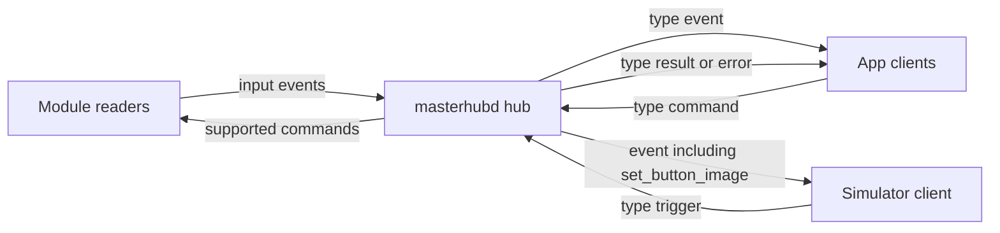

# masterhubd WebSocket API

`masterhubd` speaks a local JSON WebSocket API. Version 1 covers basic module input and a small set of output commands. USB HID layouts live in `cooltek-sdk-probe/docs/MasterHUB/`. This document does not describe HID reports.

The daemon validates messages and fans input out to connected clients. When a module is plugged in, the daemon publishes its input and writes the output commands that module supports. An M4315 publishes `key_state` and receives `set_button_image` (images larger than the 72×72 key are scaled down). An M003K publishes `knob_rotated` and `knob_state`. An M032LE publishes `roller_rotated`. An M005S publishes `slider_moved`. The base (M0064) and the 1xDial module share the M0064 big knob: the dial publishes `knob_rotated` and `knob_state`, and `set_screen_image` is written to the dial (the JPEG is fitted inside 240×240 without stretching). `set_led_mode`, `set_led_color`, and `set_led_brightness` are written to a connected M003K, M005S, or M0064. M4315 `set_screen_image` stays at the API because that module-screen HID transfer is still incomplete in the reverse-engineered notes. M032LE has no documented lighting output.

Action payloads are listed in [protocol/actions.md](protocol/actions.md).

## Endpoint

Default URL: `ws://127.0.0.1:9123`

Set `MASTERHUBD_LISTEN` to another `host:port` (for example `127.0.0.1:0` in tests). The process listens on that address and prints the bound URL on stderr.

Set `MASTERHUBD_DEBUG=1` (or `true`) to print each published action on stderr. That covers hardware input from every module and injected triggers. `data_base64` is replaced with its character count.

Frames are JSON text. Binary frames are rejected with an error message. A single frame may be at most 128 KiB; a larger frame closes the connection.

There is no authentication. Binding to localhost is the access boundary. Any connected client may send triggers. Triggers are the development injection path a simulator uses in place of USB.

## Connection

On accept, the daemon sends one hello and then reads:

```json
{ "v": 1, "type": "hello", "daemon": "masterhubd", "usb": false }
```

`usb` stays `false` in this version, including while a module is open.

## Envelope

Every message includes `v`. Version 1 is the only accepted value.

Client to daemon:

```json
{
  "v": 1,
  "type": "trigger",
  "id": "optional-correlation-id",
  "action": "knob_rotated",
  "payload": {}
}
```

`type` is `trigger` or `command`. `id`, when present, is a non-empty string and is copied onto the direct reply. `action` names the operation. `payload` is an object. Unknown fields are rejected.

Daemon to client:

| `type`   | When |
| --- | --- |
| `hello`  | Once, immediately after connect |
| `event`  | Broadcast of an accepted trigger, of `set_button_image`, or of the same action once USB reading exists |
| `result` | Direct reply to the sender of a valid trigger or command |
| `error`  | Direct reply when the message is invalid, or when a binary frame arrives |

A valid trigger is broadcast to every connected client, including the sender:

```json
{
  "v": 1,
  "type": "event",
  "action": "knob_rotated",
  "payload": {
    "module": { "model": "M003K", "id": "deck-knobs" },
    "control": 0,
    "direction": "cw"
  }
}
```

The event copies `action` and `payload`. It has no `id`. The sender also receives:

```json
{ "v": 1, "type": "result", "id": "optional-correlation-id", "ok": true }
```

`id` is omitted when the request had none. `ok: true` means the message was accepted. For commands it does not mean hardware changed.

Invalid JSON, an unknown action, a wrong module model, or an out-of-range control produces no event:

```json
{ "v": 1, "type": "error", "id": "optional-correlation-id", "message": "control 5 is out of range for M003K" }
```

`set_button_image` is also broadcast as an `event` with the same `action` and `payload`, so a simulator can paint the key. The sender still receives `result`. Other commands are not broadcast. Only the sender receives `result` or `error`.

## Modules

`payload.module` selects the device the action applies to:

```json
{ "model": "M003K", "id": "deck-knobs" }
```

`model` is one of `M003K`, `M005S`, `M0064`, `M032LE`, `M4315`. It decides which controls are legal.

`id` is a non-empty opaque string chosen by the caller. The readers publish `keys`, `knobs`, `faders`, `rollers`, and `base`.

Control indexes are 0-based. On M003K, control `0` is the top knob, `1` is the bottom-left knob, and `2` is the bottom-right knob. LED commands on M003K and M005S may use `"all"` instead of an index. M0064 lighting addresses control `0` only.

## Roles



Each reader publishes the same input events a trigger publishes. `set_button_image` is written to the connected key module and broadcast so the deck UI can show the JPEG. LED commands are written to the matching module. `set_screen_image` for M0064 is written to the dial. Commands for a module that is not connected are still accepted.

## Not in this version

Firmware, serial numbers, factory reset, calibration, software mode, LED speed, and M032LE lighting. M032LE feature reads for brightness and mode do not return data in the reverse-engineered notes, and no matching output report is documented.
